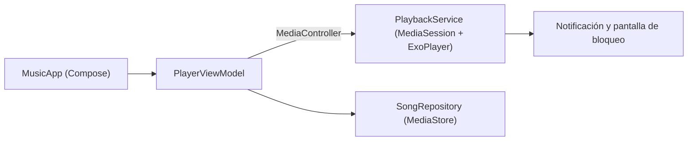

[README.md](https://github.com/user-attachments/files/33724537/README.md)
# Reproductor de música para Android

Reproductor que toca los archivos de audio guardados en el móvil. Empezó como una práctica de DAM con vistas XML y `MediaPlayer` ([versión original](https://github.com/JavierBeDo/M8_P1_parte2)) y aquí está reescrito con **Jetpack Compose** y **Media3**, con la idea de poder usarlo en el día a día y seguir ampliándolo.

<!-- Añade aquí capturas de pantalla de la app, por ejemplo:

-->

## Funciones

- Lista de la música del dispositivo, ordenada por título, con la canción actual resaltada.
- Reproducir / pausar, canción anterior y siguiente (al llegar al final o al principio de la lista, da la vuelta).
- Bucle de la canción actual.
- Barra de progreso con tiempo transcurrido y duración, con salto a cualquier punto.
- Reproducción en segundo plano, con notificación y controles en la pantalla de bloqueo.
- Se pausa sola al desconectar los auriculares o cuando otra app o una llamada necesita el audio.
- Al girar el móvil o volver a abrir la app mientras suena, continúa por donde iba.
- Solo muestra música: deja fuera tonos, notificaciones y audios de WhatsApp y Telegram.

## Tecnologías

| Área | Tecnología |
|---|---|
| Lenguaje | Kotlin |
| Interfaz | Jetpack Compose + Material 3 |
| Reproducción | Media3 (ExoPlayer, `MediaSessionService` y `MediaController`) |
| Estado | `ViewModel` + `StateFlow` |
| Concurrencia | Corrutinas |
| Lectura de música | `MediaStore` |

## Cómo está organizada



- **`MusicApp`**: pantalla con la lista de canciones y los controles. Solo dibuja el estado y avisa de los eventos.
- **`PlayerViewModel`**: guarda el estado de la interfaz y actúa como mando a distancia del reproductor.
- **`PlaybackService`**: es el dueño del reproductor. Sigue vivo con la app en segundo plano y publica la notificación.
- **`SongRepository`**: consulta `MediaStore` y devuelve la lista de canciones.

## Permisos

| Permiso | Para qué |
|---|---|
| `READ_MEDIA_AUDIO` (Android 13+) / `READ_EXTERNAL_STORAGE` (hasta Android 12L) | Leer la música del dispositivo |
| `POST_NOTIFICATIONS` (Android 13+) | Mostrar la notificación con controles |
| `FOREGROUND_SERVICE` y `FOREGROUND_SERVICE_MEDIA_PLAYBACK` | Mantener la reproducción en segundo plano |

La app pide el permiso de audio al abrirse y, una vez concedido, el de notificaciones. Sin el de notificaciones la música suena igual, pero no aparece la notificación con controles.

## Cómo ejecutarlo

1. Clona el repositorio:
   ```bash
   git clone https://github.com/JavierBeDo/<Reproductor-de-Musica-Actualizado>.git
   ```
2. Ábrelo con Android Studio y espera a que termine la sincronización de Gradle.
3. Ejecútalo en un móvil o emulador que tenga archivos de audio.
4. Acepta los permisos que pide la app.

## Limitaciones conocidas

- Solo aparecen las canciones que Android tiene indexadas en `MediaStore`. Un archivo en una carpeta que el sistema no escanea (por ejemplo, con un `.nomedia`) no saldrá en la lista.
- No hay carátulas, buscador ni listas de reproducción todavía.

## Ideas para el futuro

- Pantalla "Reproduciendo ahora" a pantalla completa.
- Carátulas de los álbumes.
- Buscador y modo aleatorio.
- Listas de reproducción y favoritos.
- Recordar la última canción al abrir la app.

## Autor

[JavierBeDo](https://github.com/JavierBeDo)
